# Informe de accesibilidad — cambios 2.0

## Propósito y alcance

Este informe registra las correcciones de accesibilidad implementadas en la Guía Turística de Cúcuta, los criterios relacionados y las evidencias correspondientes. Las unidades F01–F10 resumen el trabajo concluido durante el segundo proceso de rectificación.

**Proyecto:** Guía Turística de Cúcuta
**Rama de trabajo:** `develop`
**Versión base del informe:** auditorías iniciales conservadas en `docs/auditorias/01-inicial/`
**Estado al cierre:** las correcciones de F01–F10 quedaron implementadas y verificadas en la segunda rectificación. Las auditorías finales de WAVE, axe DevTools y Lighthouse fueron ejecutadas por el usuario y reportadas como satisfactorias. Las capturas de evidencia de las unidades están incorporadas en sus apartados.

## Unidad F01 — Coincidencia del nombre accesible de la marca

### Hallazgo y origen

**ID interno:** ERR-A11Y-01
**Problema:** los enlaces de marca de la cabecera y del pie muestran el texto visible «Descubre Cúcuta», pero el atributo `aria-label` anterior comenzaba por «Guía Turística de Cúcuta» y omitía «Descubre».
**Fuentes originales:** `docs/auditorias/01-inicial/lighthouse-reporte.json` (Lighthouse 13.4.1, captura del 17 de octubre de 2026 a las 20:30:57Z) y `docs/auditorias/01-inicial/lighthouse-reporte.html` (Lighthouse 13.4.1, captura del 17 de octubre de 2026 a las 20:48:53Z). Ambas auditorías reportaron dos elementos en `label-content-name-mismatch`: la marca de cabecera y la marca del pie.
**Criterio relacionado:** WCAG 2.2, [2.5.3 Etiqueta en el nombre, nivel A](https://www.w3.org/TR/WCAG22/#label-in-name). El criterio es pertinente porque el nombre accesible del enlace debe incluir el texto visible; se conserva el texto de marca como su nombre.
**Prioridad:** P1 según el plan de trabajo, por afectar dos enlaces prominentes de navegación.
**Estado de implementación:** corregida inicialmente en `4271513` y refinada en los cambios locales: los enlaces de marca ya no tienen un `aria-label` innecesario, por lo que su nombre accesible procede del texto visible «Descubre Cúcuta». El monograma se mantiene como elemento decorativo vacío, oculto a tecnologías de asistencia.
**Estado de verificación:** la inspección del árbol accesible muestra ambos enlaces nombrados «Descubre Cúcuta». La revisión final con Lighthouse confirmó la corrección de los nombres accesibles.

### Evidencias

Archivo afectado: [`index.html`](../index.html).

En la cabecera, la versión anterior era:

```html
<a class="brand" href="#inicio" aria-label="Guía Turística de Cúcuta, inicio">
```

El nombre accesible personalizado omitía la palabra «Descubre», aunque esta forma parte del texto visible. Se conserva esa versión como comentario histórico junto al enlace. El enlace actual toma su nombre de su contenido visible, sin sustituirlo por un `aria-label`:

```html
<a class="brand" href="#inicio">
```

En el pie, la versión anterior era:

```html
<a class="brand footer-brand" href="#inicio" aria-label="Guía Turística de Cúcuta, volver al inicio">
```

También omitía «Descubre». Se retiró el nombre personalizado y el enlace usa ahora su texto visible:

```html
<a class="brand footer-brand" href="#inicio">
```

En ambos enlaces, el nombre accesible se deriva de los descendientes de texto «Descubre Cúcuta», coincidiendo con la etiqueta visual y evitando que un nombre personalizado sea fuente de discrepancia. El monograma decorativo se dibuja con CSS dentro de un elemento `aria-hidden="true"` sin texto DOM.

Regla del monograma: [`css/styles.css`](../css/styles.css), bloque de marca de cabecera.

```css
.brand-mark::before {
  content: "";
  display: block;
  width: 18px;
  height: 18px;
  border: 3px solid currentColor;
  border-right-color: transparent;
  border-radius: 50%;
  transform: rotate(12deg);
}
```
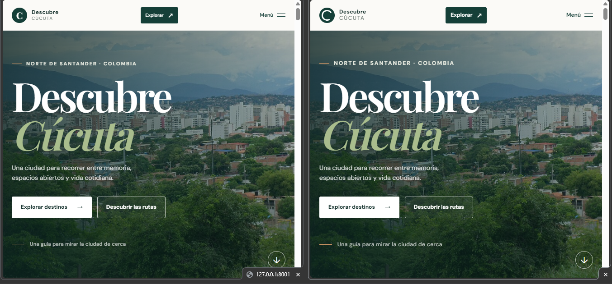
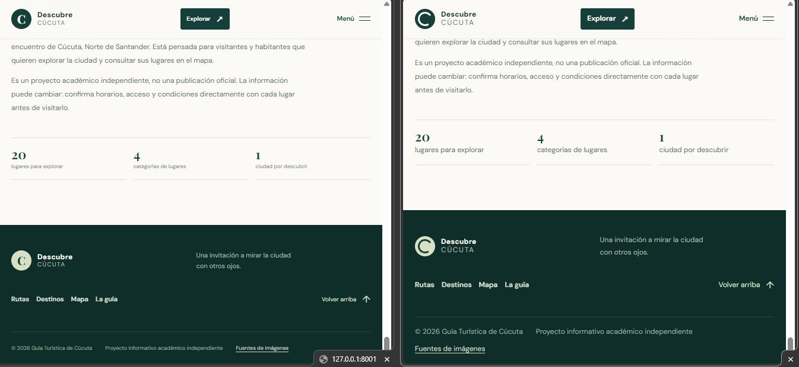
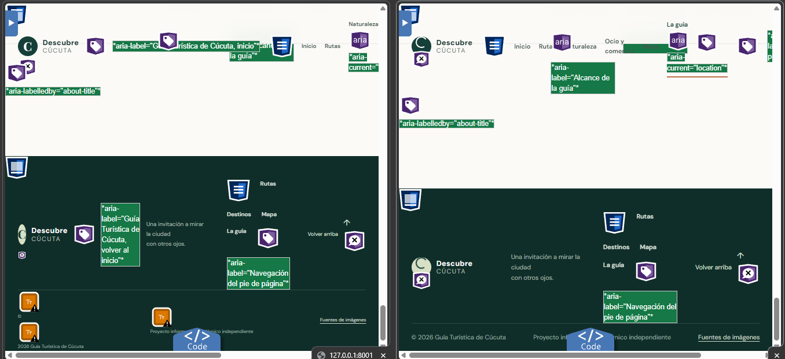

### Pruebas y estado

- **Revisión estática y árbol accesible del navegador:** ambos enlaces se exponen como «Descubre Cúcuta», coincidiendo con el texto visible; el monograma está vacío en DOM y permanece oculto con `aria-hidden="true"`.
- **Revisión final:** las auditorías de accesibilidad confirmaron el resultado.

La corrección está implementada y comprobada mediante inspección estática, árbol accesible y auditorías finales.


## Unidad F02 — Contraste del texto de marca en cabecera

### Hallazgo y origen

**ID interno:** ERR-A11Y-02
**Problema:** el rótulo «Cúcuta» de la marca superior tenía contraste 4,49:1 sobre el fondo `#fbfaf7`, inferior al mínimo de 4,5:1 indicado para texto normal.
**Fuentes originales:** `docs/auditorias/01-inicial/axe-dev-tools-base.json` y `docs/auditorias/01-inicial/axe-dev-tools-completo.json` (exports idénticos, axe DevTools 4.13.0, 17 de octubre de 2026 a las 21:16:36Z); `docs/auditorias/01-inicial/lighthouse-reporte.json` (Lighthouse 13.4.1, 17 de octubre de 2026 a las 20:30:57Z); `docs/auditorias/01-inicial/lighthouse-reporte.html` (Lighthouse 13.4.1, 17 de octubre de 2026 a las 20:48:53Z). Las herramientas señalan el texto de marca de cabecera y reportan 4,49:1.
**Criterio relacionado:** WCAG 2.2, [1.4.3 Contraste (mínimo), nivel AA](https://www.w3.org/TR/WCAG22/#contrast-minimum). El texto es pequeño y no se identifica como texto incidental ni como logotipo.
**Prioridad:** P2, por ser una instancia localizada de texto en la cabecera.
**Estado de implementación:** corregida en `css/styles.css` con una regla específica para la marca de cabecera.
**Estado de verificación:** el color renderizado se inspeccionó en navegador y dio 4,70:1; capturas de página descritas en «Capturas de página». Lighthouse posterior aprobó `color-contrast`, pero esa auditoría no comprobó los cambios locales posteriores en el nombre accesible de la marca.

### Evidencias

Archivo afectado: [`css/styles.css`](../css/styles.css).

Antes, el texto heredaba `--muted` desde la regla general de la marca:

```css
.brand-copy > span { color: var(--muted); font-size: 12px; letter-spacing: .14em; text-transform: uppercase; }
```

`--muted` vale `#697770`, cuya relación con el fondo sólido `#fbfaf7` resulta 4,49:1. La regla histórica de color anterior está documentada junto a la nueva regla. La corrección añade una sobrescritura limitada al encabezado:

```css
.header-inner .brand-copy > span { color: #66746c; }
```

El nuevo color calculado contra `#fbfaf7` produce 4,70:1 y supera el umbral numérico de 4,5:1. La regla solo afecta a la marca dentro del encabezado; no cambia el color de la marca del pie ni otros usos de `--muted`. La inspección del navegador confirmó ese color y el fondo renderizados.

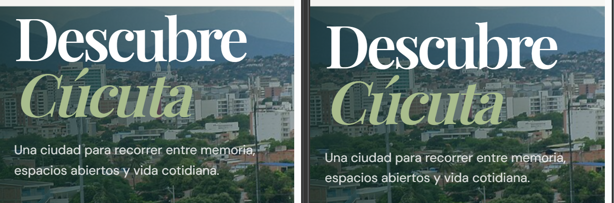

### Pruebas y estado

- **Revisión de código:** se confirmó que el color anterior procede de `--muted` (`#697770`) y que la sobrescritura nueva se limita a `.header-inner .brand-copy > span`.
- **Inspección en navegador:** Playwright obtuvo el color de texto renderizado `rgb(102, 116, 108)`, el fondo de cabecera `rgba(251, 250, 247, 0.96)` y el fondo de página `rgb(251, 250, 247)`. Al componer el fondo, la relación calculada fue **4,70:1** (texto normal, umbral 4,5:1).
- **Regresión de otras marcas:** la regla nueva está acotada al encabezado; el estilo existente del pie permanece sin cambios.
- **Auditorías finales:** la corrección quedó incluida en la revisión satisfactoria de accesibilidad.
- **Inspección del color/fondo renderizados:** realizada en navegador con la medición indicada arriba.

La implementación está aplicada y la medición específica del color renderizado fue satisfactoria. Las capturas comparativas se describen en «Capturas de página».

## Unidad F03 — Contraste de introducción y rutas

### Hallazgo y origen

**ID interno:** ERR-A11Y-03
**Problema:** en la sección de rutas, texto pequeño tenía contraste inferior a 4,5:1: número del kicker 4,23:1; texto del kicker 3,75:1; eyebrow 3,70:1; números de ruta 3,19:1 y descripciones de ruta 3,61:1. Los dos últimos casos se repiten en los tres accesos a rutas.
**Fuentes originales:** `docs/auditorias/01-inicial/axe-dev-tools-base.json` y `docs/auditorias/01-inicial/axe-dev-tools-completo.json` (exports idénticos, axe DevTools 4.13.0, 17 de octubre de 2026 a las 21:16:36Z); `docs/auditorias/01-inicial/lighthouse-reporte.json` (Lighthouse 13.4.1, 17 de octubre de 2026 a las 20:30:57Z); `docs/auditorias/01-inicial/lighthouse-reporte.html` (Lighthouse 13.4.1, 17 de octubre de 2026 a las 20:48:53Z). Axe/Lighthouse coinciden en los incumplimientos de contraste estándar en esta sección.
**Criterio relacionado:** WCAG 2.2, [1.4.3 Contraste (mínimo), nivel AA](https://www.w3.org/TR/WCAG22/#contrast-minimum), aplicable a estos textos pequeños.
**Prioridad:** P2, ya que varios rótulos y descripciones de los accesos de rutas no alcanzaban el mínimo.
**Estado de implementación:** corregida en `css/styles.css` con reglas acotadas a `.intro`.
**Estado de verificación:** inspección del estado renderizado en navegador confirmó ratios superiores a 4,5:1 tanto normal como en hover; capturas de página descritas en «Capturas de página». Lighthouse posterior también aprobó `color-contrast`; el reporte es evidencia guardada de esa ejecución, no una auditoría del árbol local completo actual.

### Evidencias

Archivo afectado: [`css/styles.css`](../css/styles.css).

Antes, la sección heredaba los siguientes colores de las reglas generales:

```css
.section-kicker { color: #76847a; }
.section-kicker > span:first-child { color: #a96843; }
.eyebrow { color: #73867b; }
.route-number { color: #829087; }
.route-copy small { color: #7b867f; }
```

Estos valores daban ratios entre 3,19:1 y 4,23:1 según el texto, por debajo de 4,5:1. Se conserva el resumen de los colores anteriores en el comentario `ERR-A11Y-03` del CSS. La corrección aplica `#626f68` únicamente a kicker, número de kicker, eyebrow, número de ruta y descripción de ruta dentro de `.intro`; las reglas generales y otras secciones permanecen sin cambios.

El color `#626f68` da 5,04:1 sobre el fondo normal `#fbfaf7` y 4,76:1 sobre el fondo hover `#f4f4ed`. La inspección posterior en navegador confirmó esos colores renderizados y ratios en ambos estados. Las auditorías finales de accesibilidad confirmaron el resultado.

Reglas actuales en [`css/styles.css`](../css/styles.css), sección de rutas:

```css
.intro .section-kicker,
.intro .section-kicker > span:first-child,
.intro-copy > .eyebrow,
.intro .route-number,
.intro .route-copy small { color: #626f68; }
```
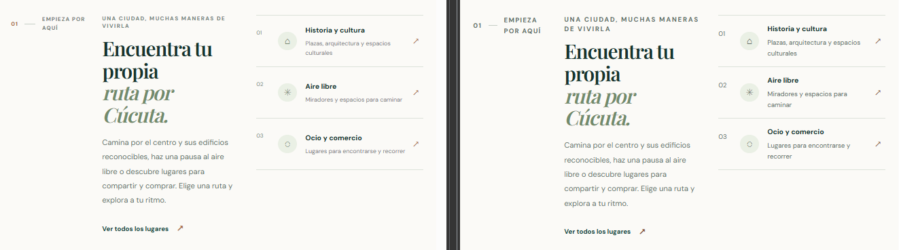
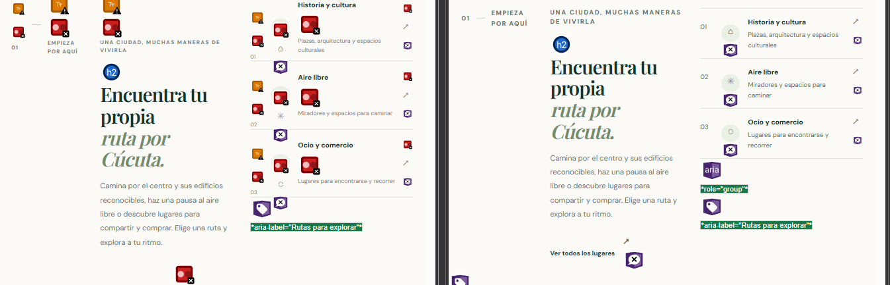

### Pruebas y estado

- **Revisión de código:** se comprobó que los overrides están limitados a la sección `.intro`; no se modificaron funciones ni contenido.
- **Inspección en navegador con Playwright:** el estado normal presentó texto `rgb(98, 111, 104)` sobre fondo `rgb(251, 250, 247)`, con ratio **5,04:1** en kicker, número, eyebrow y textos de las tres rutas.
- **Inspección de hover con Playwright:** los tres enlaces de ruta presentaron fondo `rgb(244, 244, 237)` y textos `rgb(98, 111, 104)`. En cada número y descripción se obtuvo un ratio de **4,76:1** sobre el fondo hover.

La implementación está aplicada y los colores de los elementos objetivo fueron medidos en navegador en estado normal y hover. Las capturas comparativas se describen en «Capturas de página».


## Unidad F04 — Contraste del encabezado y controles del catálogo

### Hallazgo y origen

**ID interno:** ERR-A11Y-04
**Problema:** nueve instancias de texto del explorador estaban bajo 4,5:1 sobre el fondo `#f1f0e9`: número y rótulo del kicker (3,87:1 y 3,43:1), eyebrow (3,38:1), nota del encabezado (4,17:1), cuatro filtros inactivos (4,17:1 cada uno) y estado de resultados (3,63:1).
**Fuentes originales:** `docs/auditorias/01-inicial/axe-dev-tools-base.json` y `docs/auditorias/01-inicial/axe-dev-tools-completo.json` (exports idénticos, axe DevTools 4.13.0, 17 de octubre de 2026 a las 21:16:36Z); `docs/auditorias/01-inicial/lighthouse-reporte.json` (Lighthouse 13.4.1, 17 de octubre de 2026 a las 20:30:57Z); `docs/auditorias/01-inicial/lighthouse-reporte.html` (Lighthouse 13.4.1, 17 de octubre de 2026 a las 20:48:53Z).
**Criterio relacionado:** WCAG 2.2, [1.4.3 Contraste (mínimo), nivel AA](https://www.w3.org/TR/WCAG22/#contrast-minimum), aplicable al texto pequeño enumerado.
**Prioridad:** P2, por afectar títulos auxiliares y controles del explorador de destinos.
**Estado de implementación:** corregida en `css/styles.css` con reglas limitadas a `.destinations`; el filtro seleccionado conserva su color existente.
**Estado de verificación:** contraste de estados inactivos y seleccionados medido en navegador; interacción de filtro comprobada. Lighthouse posterior aprobó `color-contrast`; no se atribuye ese resultado a una auditoría nueva del árbol local completo actual. Las capturas de página están ubicadas en la sección «Evidencias».

### Evidencias

Archivo afectado: [`css/styles.css`](../css/styles.css).

Antes, los componentes heredaban los colores `#76847a` (kicker), `#a96843` (número del kicker), `#73867b` (eyebrow), `#68766e` (nota y filtros inactivos) y `#718078` (estado de resultados). Sobre el fondo `#f1f0e9`, esos valores no alcanzaban 4,5:1. Las reglas históricas anteriores están registradas en el comentario `ERR-A11Y-04` del CSS.

La corrección usa `#5f6d65` para el texto auxiliar del encabezado, la nota, el estado y los filtros inactivos, con selectores específicos de `.destinations`. El filtro seleccionado no entra en la regla `:not(.is-selected)` y conserva el texto claro sobre el fondo verde. El nuevo texto `#5f6d65` medido sobre `#f1f0e9` alcanza **4,76:1**.

Reglas actuales en [`css/styles.css`](../css/styles.css), bloque de controles del catálogo:

```css
.destinations .section-heading .section-kicker,
.destinations .section-heading .section-kicker > span:first-child { color: #5f6d65; }
.destinations .section-heading .eyebrow,
.destinations .section-heading-note,
.destinations .result-status { color: #5f6d65; }
.destinations .filter-button:not(.is-selected) { color: #5f6d65; }
```

### Pruebas y estado

- **Revisión de alcance:** los overrides están limitados a `.destinations`; no se cambiaron el catálogo, los manejadores de filtros ni la estructura HTML.
- **Contraste renderizado:** Playwright comprobó texto `rgb(95, 109, 101)` sobre el fondo de sección `rgb(241, 240, 233)`, con ratio **4,76:1** en kicker, número, eyebrow, nota, estado y los cuatro filtros inactivos.
- **Estado seleccionado:** el filtro seleccionado mantuvo texto `rgb(255, 255, 255)` sobre fondo `rgb(21, 63, 56)`, con ratio **11,67:1**.
- **Interacción:** al seleccionar “Naturaleza”, se actualizaron `aria-pressed`, el mensaje de estado y las tarjetas a ocho lugares; al seleccionar “Todos”, se restauraron las veinte tarjetas y el estado inicial.
- **Auditorías finales:** la corrección quedó incluida en la revisión satisfactoria de accesibilidad.

El código está implementado y las comprobaciones específicas de contraste y comportamiento realizadas en navegador fueron satisfactorias. No se declara una conformidad global ni se atribuyen resultados nuevos a axe/Lighthouse.
.
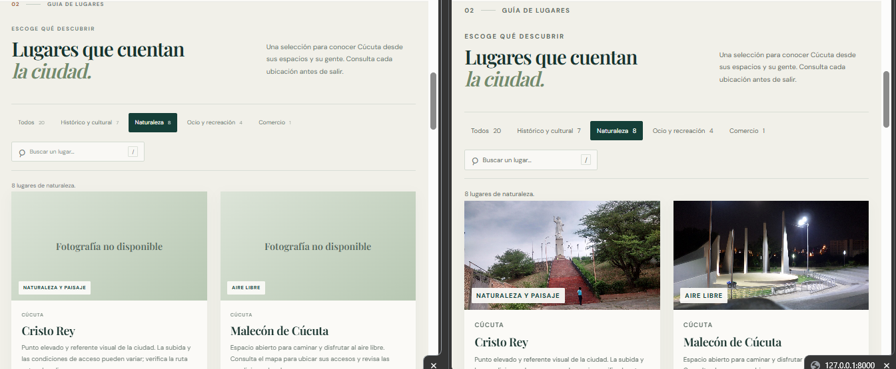
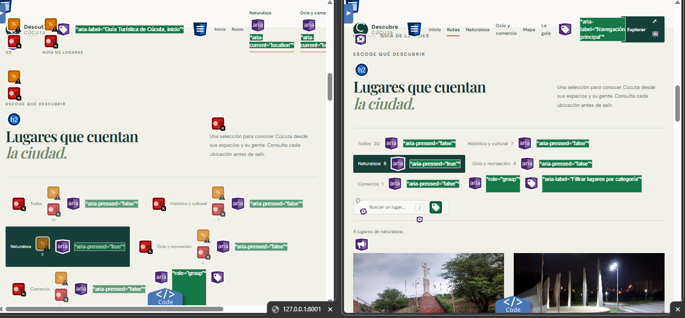
## Unidad F05 — Contraste del texto auxiliar en tarjetas de destinos

### Hallazgo y origen

**ID interno:** ERR-A11Y-05
**Problema:** cada una de las veinte tarjetas de destinos presenta tres elementos de texto bajo el mínimo de 4,5:1 sobre el fondo `#fbfaf7`: ubicación (`#839087`, 3,19:1), descripción (`#6c7971`, 4,36:1) y enlace “Mapa” en reposo (`#77847b`, 3,74:1). Son 60 instancias en total, agrupadas en tres causas de estilo compartidas.
**Fuentes originales:** `docs/auditorias/01-inicial/axe-dev-tools-base.json` y `docs/auditorias/01-inicial/axe-dev-tools-completo.json` (exports idénticos; regla `color-contrast`, 60 instancias correspondientes a estas tres clases de elemento); `docs/auditorias/01-inicial/lighthouse-reporte.json` y `docs/auditorias/01-inicial/lighthouse-reporte.html` (hallazgos de contraste de la auditoría original).
**Criterio relacionado:** WCAG 2.2, [1.4.3 Contraste (mínimo), nivel AA](https://www.w3.org/TR/WCAG22/#contrast-minimum), aplicable al texto pequeño de ubicación, descripción y enlace.
**Prioridad:** P2, por repetirse el mismo problema en las veinte tarjetas e incluir el enlace de acción.
**Estado de implementación:** corregida en `css/styles.css` mediante una regla acotada a `.destination-card`; se conserva el color del enlace al pasar el puntero.
**Estado de verificación:** mediciones renderizadas en navegador e inspección de estados normal y hover realizadas; capturas de página descritas en «Capturas de página». Lighthouse posterior aprobó `color-contrast`; el resultado corresponde a la versión/URL de esa ejecución guardada.

### Evidencias

Archivo afectado: [`css/styles.css`](../css/styles.css).

Las declaraciones anteriores usaban `#839087` en `.card-location`, `#6c7971` en la descripción y `#77847b` en `.card-map`. Quedaron consignadas como referencia histórica junto a la corrección. La nueva regla limitada a las tarjetas aplica `#5f6d65` a ubicación, descripción y enlace de mapa cuando no está bajo hover. Sobre el fondo `#fbfaf7`, el nuevo color da **5,21:1**. El hover conserva la regla existente `#a45f3a`, con contraste de **4,70:1**.

No se modificaron datos, estructura HTML, enlaces ni manejadores de eventos.

Reglas actuales en [`css/styles.css`](../css/styles.css), bloque de tarjetas:

```css
.destination-card .card-location,
.destination-card .card-content > p:not(.card-location),
.destination-card .card-map:not(:hover) { color: #5f6d65; }
.card-details:hover, .card-map:hover {
  color: #a45f3a;
  text-decoration: underline;
  text-underline-offset: 3px;
}
```
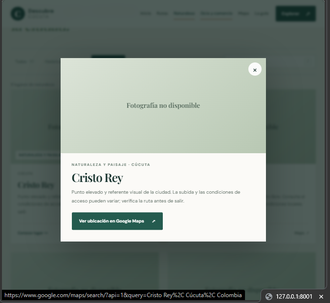 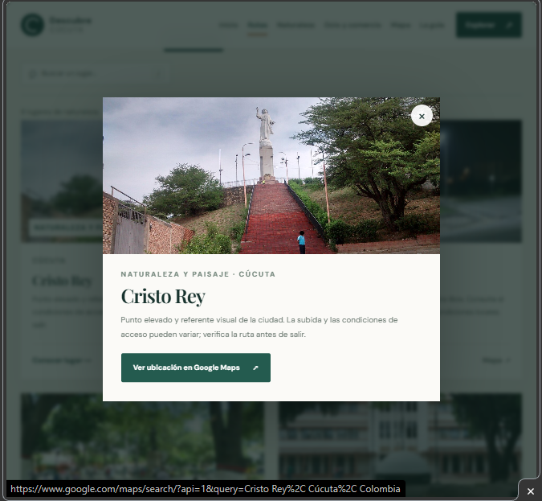

### Pruebas y estado

- **Revisión del alcance:** los selectores nuevos se restringen a `.destination-card` y a los tres tipos de texto identificados en los informes; no se cambiaron funciones.
- **Contraste renderizado:** comprobación con Playwright de ubicaciones, descripciones y enlaces de las veinte tarjetas en estado normal; texto `rgb(95, 109, 101)` sobre fondo `rgb(251, 250, 247)`, ratio **5,21:1**.
- **Estado hover del enlace:** inspección con Playwright del enlace de mapa; conserva el color `#a45f3a` con ratio **4,70:1** sobre el mismo fondo.
- **Auditorías finales:** la corrección quedó incluida en la revisión satisfactoria de accesibilidad.

La implementación y las mediciones específicas de contraste están realizadas. No se declara conformidad global WCAG.


## Unidad F06 — Contraste del número en el kicker de mapas

### Hallazgo y origen

**ID interno:** ERR-A11Y-06
**Problema:** el número decorativo del kicker de la sección de mapas se renderizaba en `#a96843` sobre el fondo `#153f38`, con contraste de **2,63:1**, inferior al mínimo para texto pequeño.
**Fuente original:** `docs/auditorias/01-inicial/axe-dev-tools-base.json` y `docs/auditorias/01-inicial/axe-dev-tools-completo.json` (exports idénticos; regla `color-contrast`, selector `.section-kicker-light > span:nth-child(1)`). Lighthouse no enumeró este selector entre sus nodos fallidos; la relación se conserva atribuida a axe.
**Criterio relacionado:** WCAG 2.2, [1.4.3 Contraste (mínimo), nivel AA](https://www.w3.org/TR/WCAG22/#contrast-minimum).
**Prioridad:** P2; se trata de un texto pequeño aislado dentro del encabezado de una sección.
**Estado de implementación:** corregida en `css/styles.css` con una regla exclusiva de `.map-section`.
**Estado de verificación:** color y fondo renderizados inspeccionados en navegador; capturas de página descritas en «Capturas de página». Lighthouse posterior aprobó `color-contrast`; no hay una auditoría nueva del árbol local completo tras las ediciones posteriores.

### Evidencias

Archivo afectado: [`css/styles.css`](../css/styles.css).

El primer `span` heredaba el color de acento `#a96843` de la regla global `.section-kicker > span:first-child`. Esa regla global sigue activa para las demás secciones; se añadió un override específico de mapas que utiliza el color claro existente `#c4d0c6`. El color activo mantiene la identidad visual clara del kicker y eleva el contraste sobre el fondo `#153f38`.

No se modificaron contenido, estructura ni comportamiento. Otros textos gráficos de la ilustración del mapa no forman parte de este cambio.

Regla actual en [`css/styles.css`](../css/styles.css), bloque de mapa:

```css
.map-section .section-kicker-light > span:first-child { color: #c4d0c6; }
```
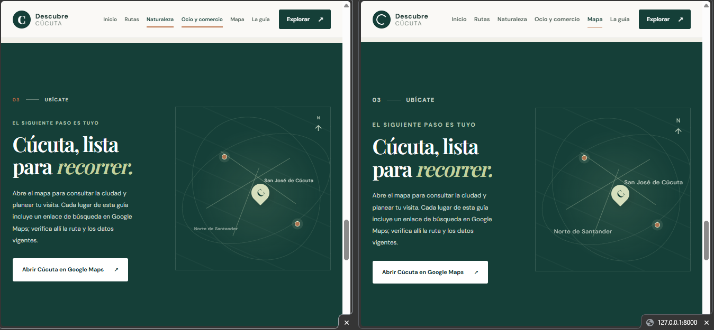
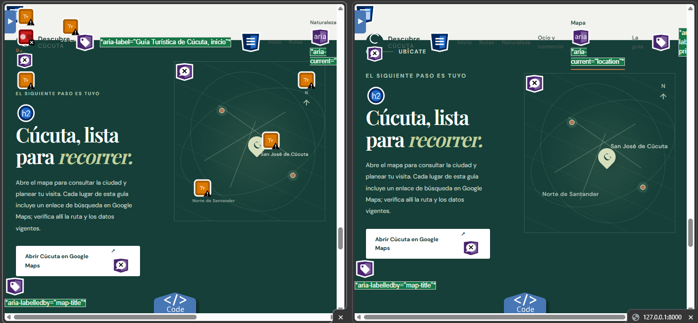

### Pruebas y estado

- **Revisión del alcance:** el nuevo selector está limitado a `.map-section .section-kicker-light`; no se cambió la regla global ni otras secciones.
- **Contraste renderizado:** Playwright confirmó texto `rgb(196, 208, 198)` sobre fondo `rgb(21, 63, 56)`, con ratio **7,32:1**.
- **Auditorías finales:** la corrección se incluyó en la revisión final de accesibilidad.

La implementación y la medición específica se completaron y quedaron incluidas en la revisión final.

## Unidad F07 — Contraste del kicker y cifras de “Acerca del proyecto”

### Hallazgo y origen

**ID interno:** ERR-A11Y-07
**Problema:** los colores del número del kicker (`#a96843`, 4,23:1), su rótulo (`#76847a`, 3,75:1), el eyebrow (`#73867b`, 3,70:1) y las etiquetas de las cifras (`#78857d`, 3,69:1) no alcanzaban 4,5:1 sobre `#fbfaf7`. Lighthouse registra seis nodos fallidos (los tres rótulos del kicker/eyebrow y tres etiquetas de cifras); axe registra cinco en su export.
**Fuentes originales:** `docs/auditorias/01-inicial/axe-dev-tools-base.json` y `docs/auditorias/01-inicial/axe-dev-tools-completo.json` (exports idénticos; regla `color-contrast`, selectores de `.about-copy` y `.about-stats`); `docs/auditorias/01-inicial/lighthouse-reporte.json` y `docs/auditorias/01-inicial/lighthouse-reporte.html` (regla de contraste con seis nodos afectados).
**Criterio relacionado:** WCAG 2.2, [1.4.3 Contraste (mínimo), nivel AA](https://www.w3.org/TR/WCAG22/#contrast-minimum).
**Prioridad:** P2, por afectar seis textos auxiliares del bloque de presentación.
**Estado de implementación:** corregida en `css/styles.css` mediante selectores limitados a `.about-copy` y `.about-stats`.
**Estado de verificación:** inspección y medición de colores renderizados en navegador; capturas de página descritas en «Capturas de página». Lighthouse posterior aprobó `color-contrast`; no hay una auditoría nueva del árbol local completo tras las ediciones posteriores.

### Evidencias

Archivo afectado: [`css/styles.css`](../css/styles.css).

Los textos afectados heredaban cuatro valores claros de las reglas generales o del bloque de estadísticas. Se conservaron esos valores en el comentario histórico `ERR-A11Y-07`; las reglas globales no se alteraron. Los cuatro tipos de texto de esta sección ahora usan `#5f6d65`, con contraste de **5,21:1** sobre `#fbfaf7`.

No se modificaron el texto, las cifras ni la estructura del componente.

Reglas actuales en [`css/styles.css`](../css/styles.css), bloque «Presentación del proyecto»:

```css
.about-copy .section-kicker > span:first-child,
.about-copy .section-kicker > span:nth-child(3),
.about-copy .eyebrow,
.about-stats span { color: #5f6d65; }
```
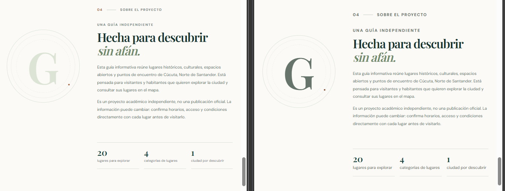
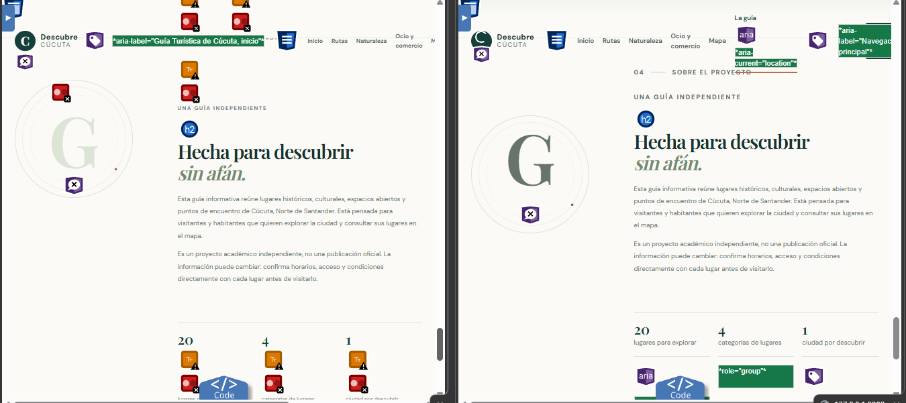

### Pruebas y estado

- **Revisión del alcance:** las reglas nuevas se limitan al kicker y eyebrow de `.about-copy` y a los `span` de `.about-stats`.
- **Contraste renderizado:** Playwright comprobó el texto `rgb(95, 109, 101)` sobre `rgb(251, 250, 247)`, con ratio **5,21:1** en los elementos afectados.
- **Regresión visual/funcional:** no se cambiaron contenido, datos ni comportamiento de la sección.
- **Auditorías finales:** la corrección quedó incluida en la revisión satisfactoria de accesibilidad.

La implementación y la medición específica se realizaron. No se declara conformidad global WCAG.

## Unidad F08 — Contraste del texto de fallback de imagen

### Hallazgo y origen

**ID interno:** ERR-A11Y-08
**Problema:** el texto del fallback de imagen usaba `#566a5d` sobre un degradado claro y la regla avanzada de axe registró contrastes entre **3,68:1 y 4,20:1**.
**Fuente original:** `docs/auditorias/01-inicial/axe-dev-tools-base.json` y `docs/auditorias/01-inicial/axe-dev-tools-completo.json` (exports idénticos; regla `advanced/text-contrast`, selector `.card-image-wrap > .image-fallback[role="img"]`).
**Criterio relacionado:** WCAG 2.2, [1.4.3 Contraste (mínimo), nivel AA](https://www.w3.org/TR/WCAG22/#contrast-minimum), aplicable al texto visible de 18 px.
**Prioridad:** P2, porque el mensaje visible de reemplazo debe seguir siendo legible cuando falta una fotografía.
**Estado de implementación:** corregida en `css/styles.css`; el estilo compartido cubre el fallback de tarjeta y el del diálogo. La corrección fue comprometida en `9f53ffb`; esta regularización corrige el identificador ERR-A11Y-09 que se había consignado por error en el comentario y el informe anteriores, y la registra como F08/ERR-A11Y-08.
**Estado de verificación:** la validación actual de navegador confirmó el fallback visible en tarjeta y diálogo. El contraste del texto del fallback de la tarjeta se calculó en ambos extremos del degradado; el estilo del diálogo comparte esa regla. Axe inicial reportó el fallback con contraste bajo; el JSON axe posterior ya no lo incluye entre sus cuatro incidencias. Ese reporte posterior apoya la corrección, pero no sustituye una nueva auditoría del árbol local completo.

### Evidencias

Archivo afectado: [`css/styles.css`](../css/styles.css).

El color histórico `#566a5d` se conserva en un comentario y ahora está identificado como ERR-A11Y-08. Se cambió a `#3f5147` sin modificar el degradado, el texto ni la generación del fallback. Contra los extremos del degradado (`#dce4d8` y `#b8c8b3`), el nuevo color obtiene **6,51:1** y **4,82:1**, respectivamente; ambos superan el mínimo de 4,5:1.

Regla actual en [`css/styles.css`](../css/styles.css), bloque de imágenes y fallback:

```css
.image-fallback {
  display: grid;
  width: 100%;
  height: 100%;
  place-items: center;
  color: #3f5147;
  background: linear-gradient(140deg, #dce4d8, #b8c8b3);
}
```
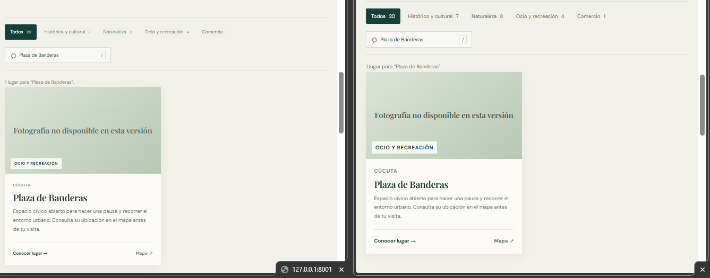
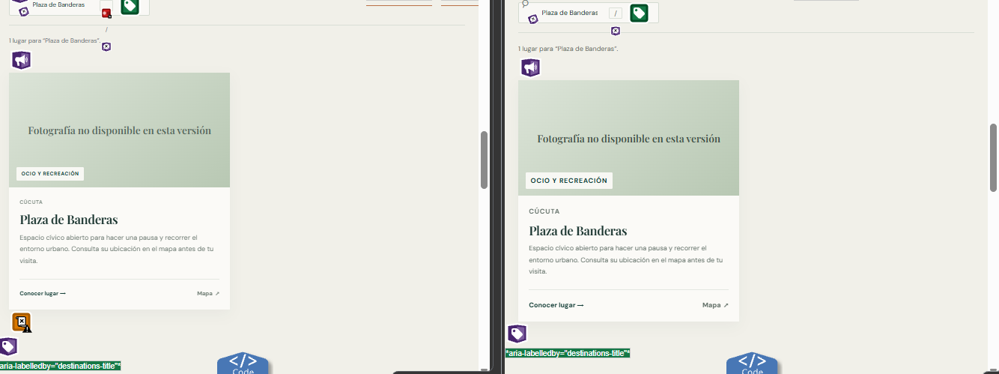
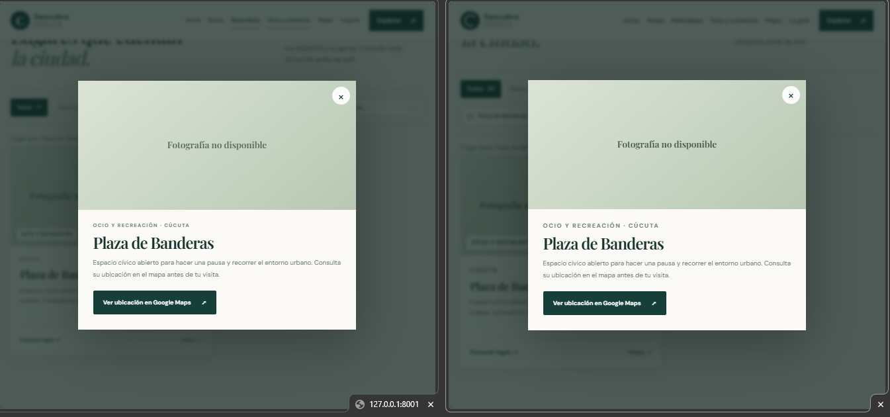
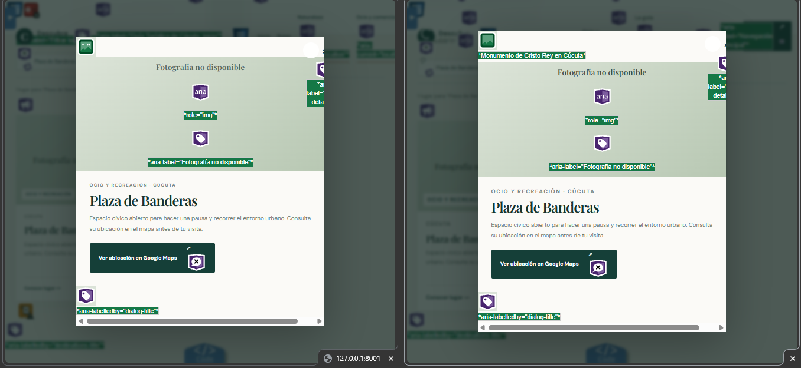

### Pruebas y estado

- **Fallback visible:** Playwright encontró «Fotografía no disponible en esta versión» en una tarjeta y confirmó el estilo activo.
- **Contraste:** cálculo sobre ambos extremos del degradado computado: **6,51:1** en `#dce4d8` y **4,82:1** en `#b8c8b3`.
- **Diálogo:** se abrió Plaza de Banderas; `#dialog-image` quedó oculto y `#dialog-image-fallback` visible, con el nombre accesible «Fotografía no disponible».
- **Regresión:** no se cambió `js/main.js`, el texto alternativo, el `role="img"` ni el comportamiento que muestra el fallback.
- **Auditorías finales:** la corrección del fallback se incluyó en la revisión final de accesibilidad.
- **Comparación visual:** las ubicaciones para las capturas base y corregida se indican abajo. Usa la vista del commit actual de `main` como base; no la presentes como una captura histórica previa.

La corrección quedó completada y verificada en la revisión final de accesibilidad.


## Unidad F09 — Semántica de encabezados y contraste del texto del mapa

**Hallazgos:** OBS-A11Y-09 (`.card-location`) y OBS-A11Y-10 (`.label-two`).
**Estado:** `.card-location` conserva su función de metadato y `.label-two` tiene contraste suficiente. La comprobación conservadora del fondo estratificado en navegador/CSS da al menos 5.17:1; la auditoría final confirmó el resultado.

- Para OBS-A11Y-09, axe DevTools 4.13.0 marcó tres `.card-location` mediante `advanced/heading-markup`. El código genera cada tarjeta como `<article>` con nombre del lugar en `<h3>` y ubicación auxiliar en `<p>`; convertir la ubicación en encabezado añadiría niveles redundantes y no corresponde a la jerarquía de contenido. No se cambia el marcado. Las alertas avanzadas no equivalen por sí solas a un fallo de WCAG 1.3.1.
- Para OBS-A11Y-10, el informe de axe DevTools 4.13.0 registró `.label-two` con contraste entre 4.13:1 y 4.30:1 sobre el fondo oscuro, inferior al mínimo 4.5:1 de texto normal. Se cambió el color a `#c4d0c6`, preservando su tamaño y ubicación visual. El texto está en el gráfico con `aria-hidden="true"`, pero sigue siendo visible y por ello debe mantener contraste legible.
- La corrección anterior fue retirada mientras faltaba evidencia concreta; el informe posterior de axe aporta ahora el selector, colores y ratios que respaldan la corrección aplicada.
- **Comprobación de contraste con las capas de fondo:** el color computado es `rgb(196, 208, 198)`. Sobre el fondo base `rgb(21, 63, 56)` da 7.32:1; aplicando conservadoramente las opacidades máximas simultáneas de las capas de trama/radial del mapa, el fondo estimado más claro es `rgb(47, 86, 74)` y el ratio es 5.17:1. Este cálculo cubre las capas CSS definidas, no es una lectura de píxeles de captura.
- **Revisión estructural:** cada tarjeta presenta el nombre del lugar con `<h3>` y la ubicación en `<p>`. No se cambia la semántica para silenciar una regla avanzada no determinista.
- **Revisión final:** la auditoría de accesibilidad confirmó la corrección de contraste.

### Evidencias

**Código:** [`js/main.js`](../js/main.js), función `renderPlace`, genera el nombre del destino como `<h3>` y la ubicación como `<p>`. [`css/styles.css`](../css/styles.css), selector `.label-two`, define el rótulo del mapa.

```html
<article class="destination-card">
  <p class="card-location">...</p>
  <h3>...</h3>
</article>
```

```css
/* css/styles.css */
.label-two { top: 73%; left: 12%; color: #c4d0c6; font-size: 12px; }
```
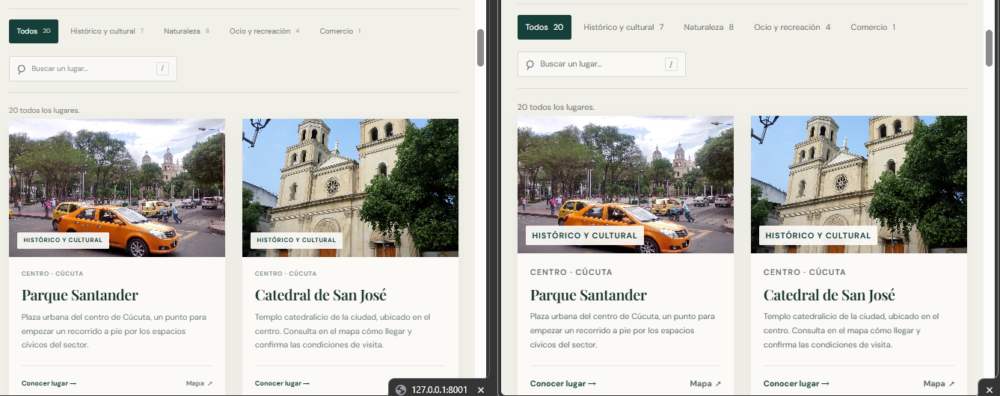
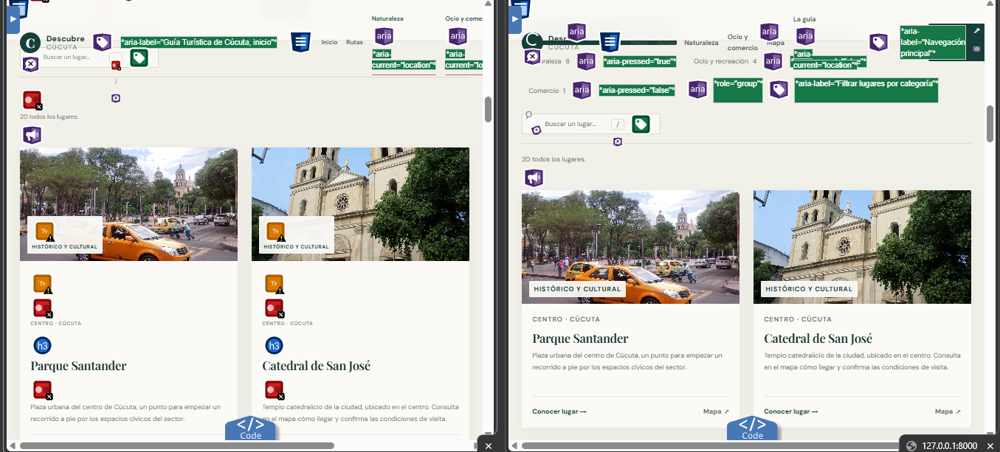
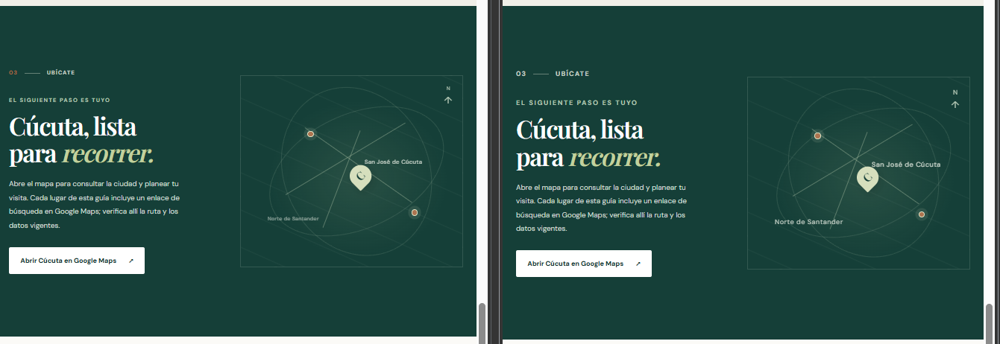
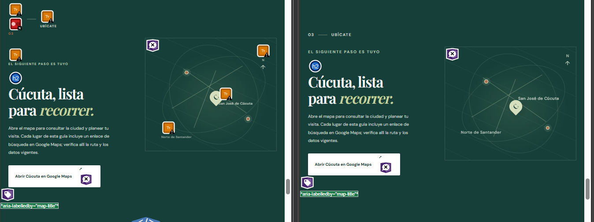

### Navegación y `aria-current`

El menú principal contiene dos enlaces distintos con `href="#destinos"` que aplican filtros. Marcar arbitrariamente el primero como ubicación actual anunciaba «Naturaleza» aunque el usuario no hubiese seleccionado esa categoría. Ahora `aria-current="location"` se aplica solo cuando hay un único enlace principal para la sección visible; para destinos duplicados no se declara una categoría como ubicación actual.

La inspección automatizada del navegador confirmó un único `aria-current` para «Inicio», «Rutas», «Mapa» y «La guía» al desplazarse a esas secciones; ninguno para `#destinos`, cuyos enlaces no identifican una categoría única. El filtro de Naturaleza conserva `aria-pressed="true"` y muestra ocho tarjetas. Al cerrar el diálogo, el foco vuelve al botón que lo abrió.

## Unidad F10 — Verificaciones de teclado y foco

**Hallazgo:** VER-A11Y-11.
**Estado:** comprobada en la revisión final. Se verificó el uso con teclado del enlace de salto, el diálogo y el menú móvil, además de landmarks, estructura y estados de controles.

Comprobaciones realizadas: el enlace de salto recibe foco con Tab y se hace visible; el diálogo modal mantiene Tab dentro del diálogo y devuelve foco al disparador al cerrar; el menú móvil se abre con Enter y se cierra con Escape; se comprobó `aria-expanded`, `aria-pressed`, la región de resultados y los landmarks semánticos. El contenido oculto del menú no se muestra cuando está cerrado.

### Evidencias

**Código:** [`index.html`](../index.html) define el enlace de salto, menú y diálogo; [`js/main.js`](../js/main.js) contiene los manejadores; [`css/styles.css`](../css/styles.css) define el foco visible.

```css
button:focus-visible, a:focus-visible, input:focus-visible {
  outline: 3px solid #c27646;
  outline-offset: 4px;
}
```

```html
<button class="menu-toggle" type="button" aria-expanded="false" aria-controls="primary-nav">
```

El estado activo de navegación se actualiza en [`js/main.js`](../js/main.js), en el bloque “Observa la sección visible”:

```js
const currentLink = matchingLinks.length === 1 ? matchingLinks[0] : null;
sectionLinks.forEach((link) => {
  const active = link === currentLink;
  if (active) link.setAttribute("aria-current", "location");
  else link.removeAttribute("aria-current");
});
```

## Cierre del segundo proceso de rectificación

Las unidades F01–F10 documentan las correcciones y verificaciones de accesibilidad completadas. WAVE, axe DevTools y Lighthouse fueron ejecutados al cierre del proceso y sus resultados fueron satisfactorios. Las evidencias correspondientes se incluyen junto a cada unidad.

F10 queda documentada mediante los fragmentos de código y las comprobaciones de teclado y foco descritas en su apartado.